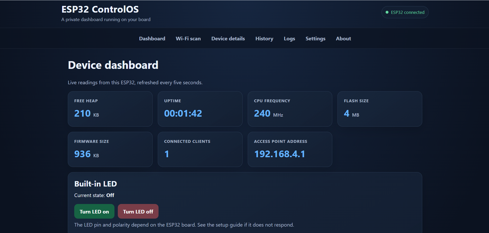
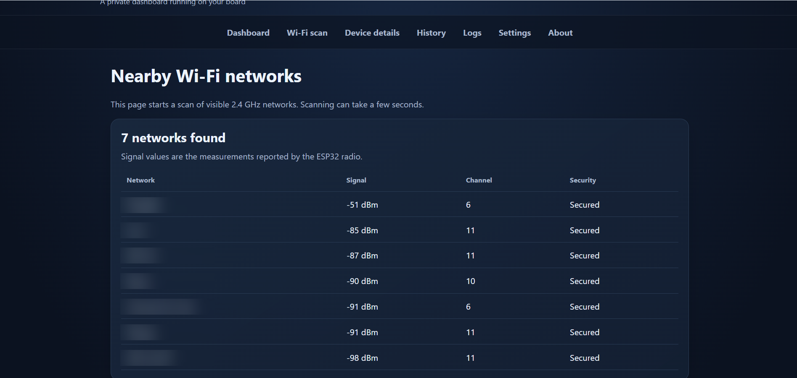
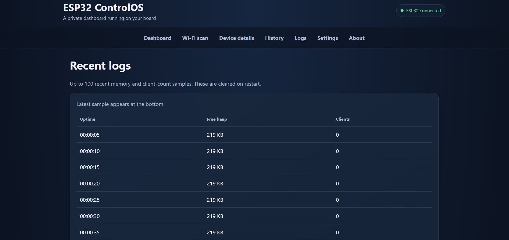
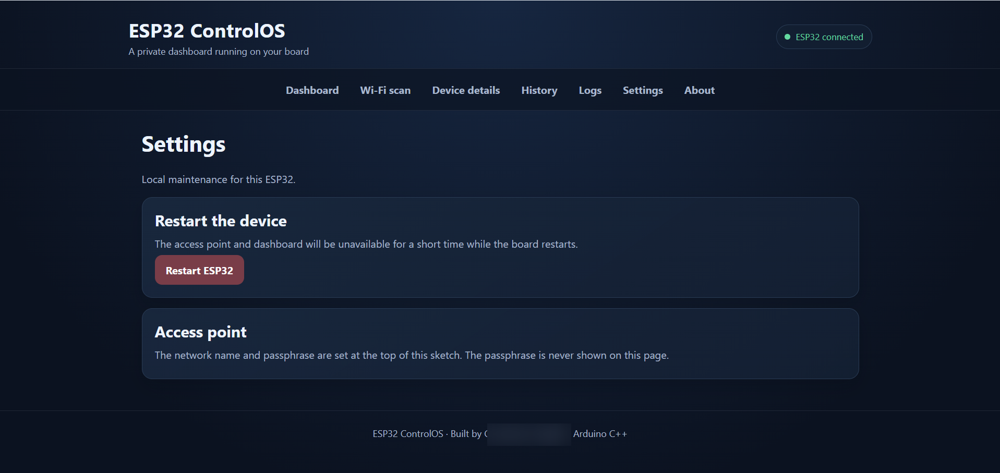
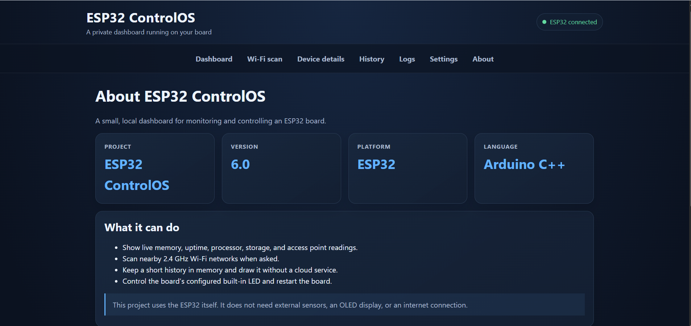
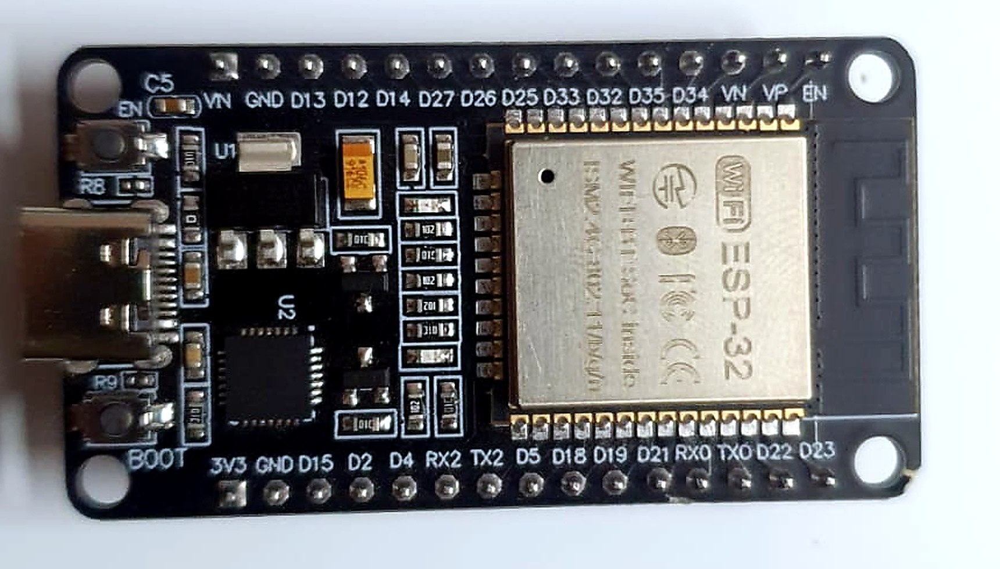
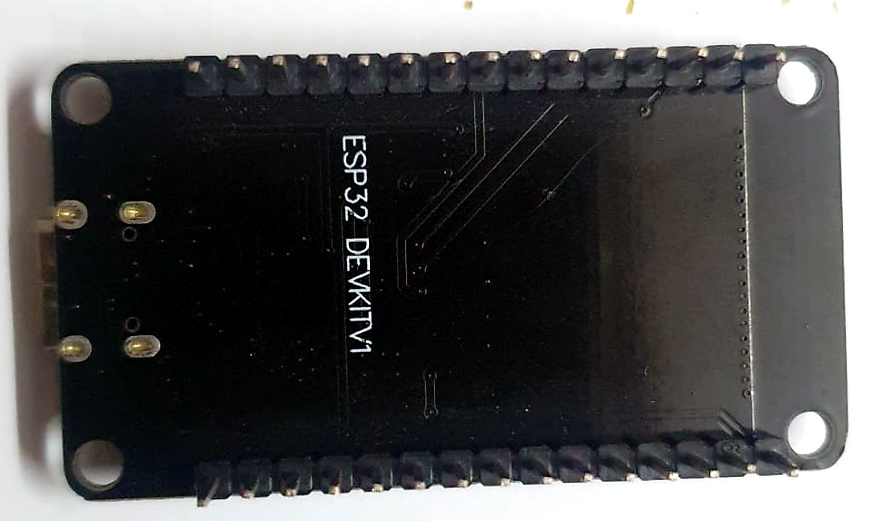

# ESP32 ControlOS V6

**A local-first web dashboard for monitoring and controlling an ESP32—hosted entirely on the board itself.**

Connect from a phone or laptop to view live device information, scan nearby 2.4 GHz Wi-Fi networks, review recent telemetry, control the configured built-in LED, and restart the board. No cloud service, home router, external sensors, or OLED display is required.

## Contents

- [Features](#features)
- [Hardware](#hardware)
- [Quick start](#quick-start)
- [Dashboard routes](#dashboard-routes)
- [Design and data](#design-and-data)
- [Security and privacy](#security-and-privacy)
- [Build and verification](#build-and-verification)
- [Screenshots and hardware evidence](#screenshots-and-hardware-evidence)
- [Troubleshooting](#troubleshooting)
- [License](#license)

## Features

- **Live device status:** free heap, uptime, CPU frequency, flash size, firmware size, connected clients, and access-point address.
- **Wi-Fi scan:** on-demand nearby-network scanning with network names, channels, security, and measured signal strength.
- **Recent history:** in-memory free-memory and client-count trends with a log view.
- **Local controls:** switch the configured built-in LED on/off and restart the ESP32.
- **Local data path:** dashboard pages and JSON readings are served by the ESP32; telemetry is not sent to a cloud service.
- **Two sketch formats:** a configurable main sketch and an optional single-file version.

## Hardware

- **Test board reported by the project owner:** ESP32 DevKit V1.
- An ESP32 board supported by the Espressif Arduino core.
- A USB data cable for uploading firmware.

The default LED setting is GPIO 2, which is common on ESP32 DevKit boards. Built-in LED pins and active polarity vary by board; some boards do not expose a built-in LED. Adjust `CONTROL_OS_LED_PIN` and `CONTROL_OS_LED_ACTIVE_LOW` in the configuration for your board.

## Quick start

### 1. Configure the Wi-Fi access point

For the **main sketch**:

1. Copy `config.example.h` to a new file named `config.local.h` in the repository root, beside `ESP32-ControlOS-V6.ino`.
2. Set `CONTROL_OS_WIFI_SSID` and replace `CHANGE_ME_PRIVATE_PASSWORD` with your own WPA2 passphrase of 8–63 characters.
3. Keep `config.local.h` private. It is listed in `.gitignore` and should never be committed.

The example intentionally uses a placeholder password. If no private configuration is supplied, the main firmware refuses to start the access point.

### 2. Build and upload

1. Install the **Espressif ESP32 board package** in Arduino IDE.
2. Open `ESP32-ControlOS-V6.ino` from the repository root.
3. Select **ESP32 Dev Module** or the matching board profile for your specific hardware, and select its serial port.
4. Upload the sketch.
5. Open Serial Monitor at **115200 baud**. The firmware prints the access-point name and local address, not the passphrase.

### 3. Open the dashboard

Connect your phone or computer to the ESP32's Wi-Fi network, then open [http://192.168.4.1](http://192.168.4.1).

The ESP32 creates its own local network; it does not connect to your home router or to the networks listed by the scan page. Your phone may warn that this Wi-Fi network has no internet access. That is expected.

### Optional: single-file sketch

If you prefer a single file, open `ESP32-ControlOS-V6-SingleFile/ESP32-ControlOS-V6-SingleFile.ino` from its own folder in Arduino IDE. Set the SSID and password constants near the top before uploading. The committed password is a placeholder, and the access point will not start until a private WPA2 passphrase of 8–63 characters is configured.

## Dashboard routes

| Method | Path | Purpose |
| --- | --- | --- |
| GET | `/` | Live dashboard |
| GET | `/wifi` | Scan nearby Wi-Fi networks |
| GET | `/system` | Device details |
| GET | `/charts` | Automatically refreshed history chart |
| GET | `/logs` | Recent readings in time order |
| GET | `/settings` | Restart control and setup note |
| GET | `/about` | Features, privacy, and project information |
| GET | `/status` | Current readings as JSON |
| GET | `/history` | Recent readings as JSON |
| POST | `/on` and `/off` | Turn the configured LED on or off |
| POST | `/restart` | Restart the ESP32 |

Wi-Fi names are escaped before display. Signal strength is reported as measured dBm, not an invented quality percentage. Normal dashboard polling does not trigger additional Wi-Fi scans.

## Design and data

The firmware serves the pages and JSON endpoints with the ESP32's embedded HTTP server. It stores up to 100 samples in RAM, normally one sample every five seconds—about eight minutes and twenty seconds. Samples are not saved permanently and are cleared on restart. Wi-Fi scanning can briefly delay sampling.

See [Architecture and Design](docs/ARCHITECTURE.md) for the system diagram, routes, storage behavior, configuration variants, and security boundaries.

## Security and privacy

- The access point uses WPA2. Choose a private passphrase and never reuse the one from your home network.
- State-changing POST requests check a random token created at boot to help mitigate cross-site form submissions.
- This token is **not** a user-account system. Anyone with the access-point password can load the dashboard and use its controls.
- Device telemetry stays local; the firmware does not send readings to a cloud service.
- Do not paste passwords into issues, pull requests, screenshots, or serial logs.

Read the [security policy](SECURITY.md) before reporting a possible vulnerability.

## Build and verification

The [GitHub Actions build](https://github.com/yenigellagnandeep-commits/ESP32-ControlOS-V6/actions/workflows/esp32-build.yml) runs on pushes and pull requests to `main`. It:

1. Checks the main and single-file sketches stay synchronized outside documented configuration/setup differences.
2. Checks that private configuration stays ignored and selected password, control-token, and HTML-escaping safeguards remain present.
3. Compiles both sketch variants for the `esp32:esp32:esp32` target.
4. Checks repository-local Markdown links/images and verifies the README route table against the registered firmware routes.

A passing build confirms compilation for the configured target; it does not independently prove physical-board behavior.

## Screenshots and hardware evidence

**Latest owner-reported live run: 25 October 2026.** The dashboard was opened from a client connected to the ESP32 access point. The submitted screenshots show the connected status indicator, live device readings, a successful scan showing seven nearby 2.4 GHz networks, the device-details page, a populated history chart, recent logs, settings, and the About page.

Values visible in the captured session included 240 MHz CPU frequency, 4 MB flash, a 936 KB firmware image, and the access point at 192.168.4.1. Memory and uptime are live measurements and will naturally differ between runs. These screenshots demonstrate the reported session; they are not a substitute for a repeatable test log or automated hardware test.

**Privacy before publishing screenshots:** blur personal names and every nearby Wi-Fi network name. Do not publish access-point passwords, tokens, serial numbers, or other secrets. Signal strength, channel, and security columns can remain visible if desired.

See the [hardware test report](docs/HARDWARE_TEST_REPORT.md) for the distinction between owner-reported physical testing and automated CI checks.

View dashboard screenshots

### Dashboard

### Nearby Wi-Fi scan

### Device details

### Recent history

### Recent logs

### Settings

### About

View the test board

| Front | Back |
| --- | --- |
|  |  |

For contributor expectations, see [CONTRIBUTING.md](CONTRIBUTING.md). For manual test limitations and the next test-record template, see [the hardware test report](docs/HARDWARE_TEST_REPORT.md).

## Troubleshooting

- **The access point does not appear:** Check Serial Monitor. The firmware refuses to start while the placeholder password is configured; use a private 8–63 character passphrase.
- **The dashboard does not open:** Connect to the ESP32's own access point and open http://192.168.4.1.
- **The LED does not respond:** Confirm your board's LED pin and polarity, then adjust `CONTROL_OS_LED_PIN` and `CONTROL_OS_LED_ACTIVE_LOW`.
- **The Wi-Fi scan is empty:** The ESP32 scans 2.4 GHz networks only. Try again closer to the access point you're looking for.

## License

This project is licensed under the [MIT License](LICENSE).
