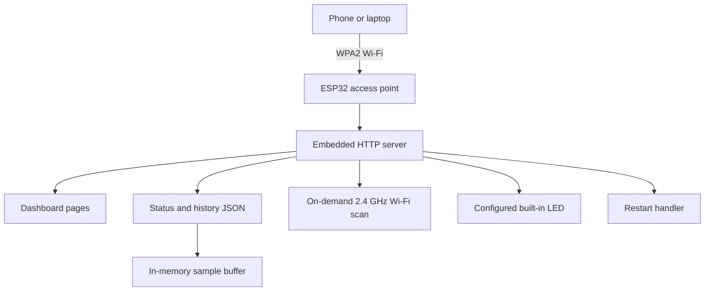

# Architecture and Design

ESP32 ControlOS is a local-first dashboard hosted by the ESP32. A phone or laptop connects directly to the board's password-protected access point; the board serves the user interface and JSON endpoints locally.

## System overview

The device does not join the user's home router, require an internet connection, or send telemetry to a cloud service.

## Request surface

| Method | Path | Responsibility |
| --- | --- | --- |
| GET | `/` | Live dashboard |
| GET | `/wifi` | Scan nearby 2.4 GHz Wi-Fi networks |
| GET | `/system` | Device details |
| GET | `/charts` | Recent telemetry charts |
| GET | `/logs` | Recent readings in time order |
| GET | `/settings` | Restart control and setup note |
| GET | `/about` | Project and privacy information |
| GET | `/status` | Current readings as JSON |
| GET | `/history` | Recent samples as JSON |
| POST | `/on` | Switch the configured LED on |
| POST | `/off` | Switch the configured LED off |
| POST | `/restart` | Restart the ESP32 |

## Runtime and storage

- The dashboard and data endpoints are served by the firmware; no separate web server is needed.
- Up to 100 telemetry samples are held in RAM, normally at five-second intervals. Samples are lost when the board restarts.
- Wi-Fi scanning happens on the scan page rather than during normal dashboard polling. A scan can briefly delay sampling.
- The default LED pin is GPIO 2. The correct pin and active polarity depend on the board.

## Configuration variants

The root sketch, `ESP32-ControlOS-V6.ino`, reads Wi-Fi and LED settings from `config.local.h` when present, with `config.example.h` as the documented template. The local file is ignored by Git.

The optional sketch in `ESP32-ControlOS-V6-SingleFile/` keeps its configuration at the top of the file. It exists for users who prefer to open one self-contained sketch. The CI synchronization check protects shared firmware logic across both variants while allowing their configuration/setup text to differ.

## Security boundaries

The access point uses WPA2, and state-changing POST handlers check a random token generated at boot to help mitigate cross-site form submissions. This is not a user-account system and does not provide separate permissions to clients on the access point. Treat anyone who has the Wi-Fi passphrase as trusted to operate the board. Do not reuse a home-network password.

## Verification boundaries

GitHub Actions checks the firmware compiles for the ESP32 Dev Module target, checks the two sketch variants remain synchronized, verifies selected security/configuration invariants, and validates local Markdown links and route documentation. These automated checks do not replace testing on the exact physical board. The owner-reported hardware results and their limitations are recorded in [the hardware test report](HARDWARE_TEST_REPORT.md).
